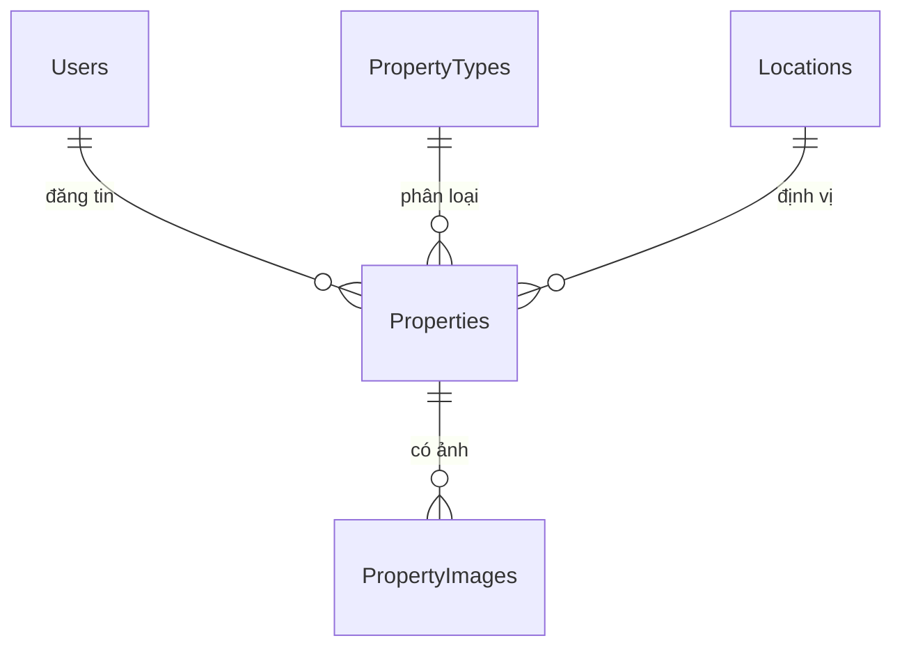

# Mô hình dữ liệu toàn bộ RealEstateWeb

## Quan hệ

Một bất động sản bắt buộc thuộc một người đăng, một loại và một khu vực. Không xóa người đăng, loại hoặc khu vực khi còn tin tham chiếu. Xóa tin sẽ xóa các ảnh phụ thuộc. Giá trị MainImage nằm trực tiếp trong Properties để giao diện hiện tại hiển thị ảnh; PropertyImages lưu bộ ảnh cho chức năng mở rộng. Bản tuần 11 có CRUD bộ ảnh và hiển thị ảnh trên trang chi tiết.

## Ánh xạ chức năng hiện có

| Chức năng | Bảng sử dụng | Nơi xử lý |
|---|---|---|
| Đăng ký, đăng nhập, phân quyền | Users | Controllers/AccountController.cs |
| Trang chủ | Properties, PropertyTypes, Locations | Controllers/HomeController.cs |
| Tìm kiếm, lọc, phân trang | Properties, PropertyTypes, Locations | Controllers/PropertyController.cs |
| Chi tiết và thông tin người đăng | Properties, PropertyTypes, Locations, Users | Controllers/PropertyController.cs |
| Thống kê quản trị | Properties, Users | Areas/Admin/Controllers/HomeController.cs |
| CRUD và duyệt/từ chối tin | Properties, PropertyTypes, Locations, Users | Areas/Admin/Controllers/PropertiesController.cs |
| CRUD loại bất động sản | PropertyTypes, Properties | Areas/Admin/Controllers/PropertyTypesController.cs |
| Lưu nhiều ảnh theo model | PropertyImages | Areas/Admin/Controllers/PropertyImagesController.cs |

## Từ điển dữ liệu

Tất cả khóa chính INT đều tự tăng IDENTITY(1,1). Cột ghi “Có” ở cột NULL được phép bỏ trống. NVARCHAR lưu tiếng Việt; tiền VND; diện tích m². DATETIME2 lưu giá trị ngày giờ, định dạng dd/MM/yyyy thuộc phần hiển thị.

### Users — tài khoản

| Cột | Kiểu SQL Server | NULL | Ý nghĩa |
|---|---|---|---|
| UserId | INT | Không | Khóa chính |
| FullName | NVARCHAR(100) | Không | Họ tên |
| Email | NVARCHAR(150) | Không | Email duy nhất, dùng đăng nhập |
| PasswordHash | NVARCHAR(MAX) | Không | Mật khẩu đã băm theo ASP.NET Identity |
| Phone | NVARCHAR(20) | Có | Điện thoại |
| Address | NVARCHAR(255) | Có | Địa chỉ |
| Role | NVARCHAR(20) | Không | Admin hoặc User; mặc định User |
| Status | NVARCHAR(20) | Không | Active, Inactive hoặc Locked; chỉ Active được đăng nhập |
| CreatedAt | DATETIME2(7) | Không | Ngày tạo |

### PropertyTypes — loại bất động sản

| Cột | Kiểu SQL Server | NULL | Ý nghĩa |
|---|---|---|---|
| PropertyTypeId | INT | Không | Khóa chính |
| TypeName | NVARCHAR(100) | Không | Tên loại: căn hộ, nhà phố… |
| Description | NVARCHAR(500) | Có | Mô tả loại |

### Locations — khu vực

| Cột | Kiểu SQL Server | NULL | Ý nghĩa |
|---|---|---|---|
| LocationId | INT | Không | Khóa chính |
| City | NVARCHAR(100) | Không | Tỉnh/thành phố |
| District | NVARCHAR(100) | Có | Khu vực theo model và dữ liệu hiện tại |

Các nhãn Quận 1, Quận 7, TP. Thủ Đức giữ theo dữ liệu mẫu của project để minh họa bộ lọc; không dùng làm danh mục hành chính hiện hành.

### Properties — tin bất động sản

| Cột | Kiểu SQL Server | NULL | Ý nghĩa |
|---|---|---|---|
| PropertyId | INT | Không | Khóa chính |
| Title | NVARCHAR(200) | Không | Tiêu đề tin |
| Description | NVARCHAR(MAX) | Không | Nội dung mô tả |
| Price | DECIMAL(18,2) | Không | Giá, lớn hơn hoặc bằng 0 |
| Area | DECIMAL(10,2) | Không | Diện tích từ 1 đến 100000 m² |
| Address | NVARCHAR(255) | Không | Địa chỉ cụ thể |
| PropertyTypeId | INT | Không | Khóa ngoại đến PropertyTypes |
| LocationId | INT | Không | Khóa ngoại đến Locations |
| UserId | INT | Không | Khóa ngoại đến Users, người đăng |
| Bedrooms | INT | Không | Phòng ngủ từ 0 đến 50 |
| Bathrooms | INT | Không | Phòng tắm từ 0 đến 50 |
| Status | NVARCHAR(30) | Không | Pending, Approved, Rejected, Sold |
| MainImage | NVARCHAR(255) | Có | Đường dẫn ảnh đại diện |
| IsFeatured | BIT | Không | Tin nổi bật |
| CreatedAt | DATETIME2(7) | Không | Ngày tạo |
| UpdatedAt | DATETIME2(7) | Có | Lần cập nhật; ứng dụng chủ động gán |

Status mặc định Pending. Approved hiển thị ngoài User. Rejected và Sold không nằm trong kết quả public hiện tại. Vai trò người đăng được ứng dụng chọn trong danh sách User; FK chỉ kiểm tra tài khoản có tồn tại.

### PropertyImages — bộ ảnh

| Cột | Kiểu SQL Server | NULL | Ý nghĩa |
|---|---|---|---|
| PropertyImageId | INT | Không | Khóa chính |
| PropertyId | INT | Không | Khóa ngoại đến Properties, xóa cascade |
| ImageUrl | NVARCHAR(255) | Không | Đường dẫn ảnh |
| IsMain | BIT | Không | Đánh dấu ảnh chính; mặc định 0 |

Bản tuần 11 đồng bộ MainImage/IsMain trong controller khi thay ảnh chính. Mỗi lần SaveChanges cập nhật các bản ghi liên quan. Không thêm trigger; nếu chỉnh SQL trực tiếp cần tự giữ hai giá trị nhất quán.

## Chỉ mục

- IX_Users_Email: unique, phục vụ đăng nhập và kiểm tra email trùng.
- IX_Properties_PropertyTypeId, IX_Properties_LocationId, IX_Properties_UserId: chỉ mục khóa ngoại.
- IX_PropertyImages_PropertyId: lấy ảnh theo tin, hỗ trợ xóa tin.
- IX_Properties_Status_CreatedAt: hỗ trợ lọc trạng thái và sắp xếp ngày đăng. Không thay thế chỉ mục toàn văn cho tìm kiếm chứa từ khóa.

## Phạm vi

Không có nghiệp vụ đặt tour, giỏ hàng, đơn hàng hoặc thanh toán trong project đã gửi; vì vậy không tạo các bảng nghiệp vụ đó. Template có tên và ảnh khách sạn nhưng model/controller thực tế là quản lý bất động sản. Toàn bộ 5 model đã được bao phủ.

## Cấu hình EF trong bản cập nhật tuần 11

Data/ApplicationDbContext.cs ánh xạ tường minh 5 bảng, độ dài, decimal, default, CHECK và khóa ngoại. Data/ApplicationDbContext.Custom.cs giữ chỉ mục bổ sung qua partial method. Metadata MVC của Location tách riêng, còn cấu hình cột SQL vẫn đặt trong DbContext. Không có migration mới và không đổi schema SQL so với bộ đã cung cấp.
